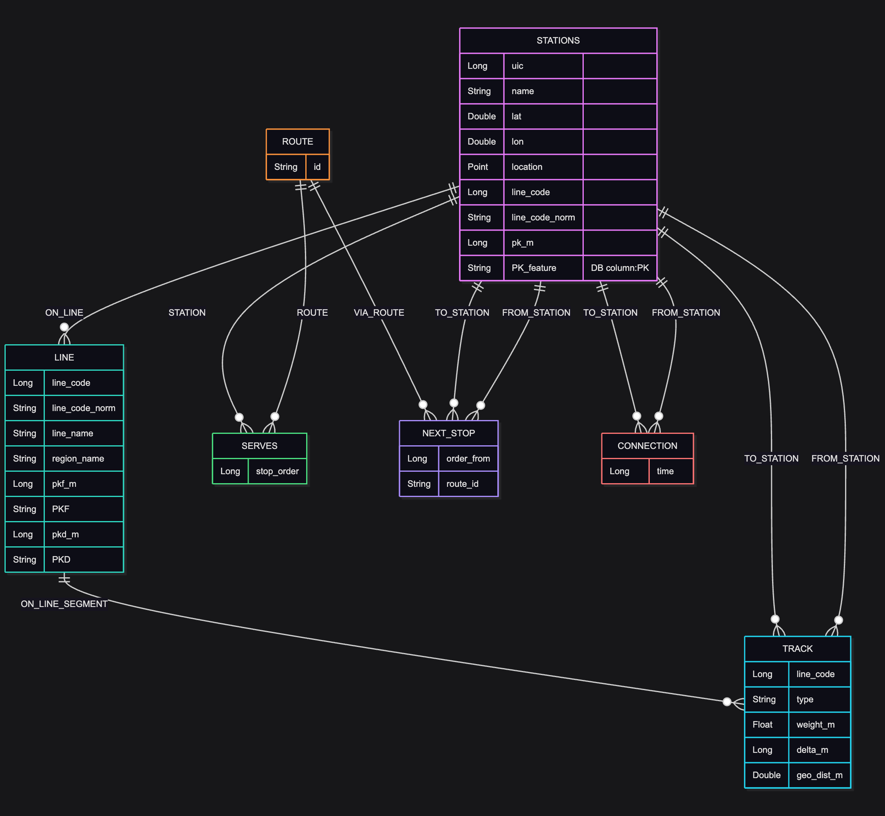

# Finding the Best Heist Route from the Louvre

The French rail network as a Neo4j graph. Project 3 for DATASCI 205, Fundamentals of Data Engineering, UC Berkeley Master of Information and Data Science, Fall 2025.

Our team of four turned a routing problem into a heist. Someone walks out of the Louvre with a painting. What is the best way out of Paris, and then out of France, by train? We treated it as a graph question on real open transport data: from the Louvre metro stop, through three exit corridors (Gare du Nord, Gare de l'Est and Paris Gare de Lyon), to nine exit cities.

I built the national side of the answer: the SNCF rail network as a Neo4j graph of 6,062 stations and 993 lines. The open data lists stations and lines, and no connections between stations. I loaded both with Cypher from Python, derived the track topology from kilometer posts and station coordinates, weighted it by distance in meters, and ran connected components, centrality and Dijkstra shortest paths on it with Neo4j Graph Data Science. The team then used my station list to validate its merged network and my degree centrality ranking to choose the stations it removed when testing the escape routes.

What we found is that a shortest path is not yet a route. My graph reached Nice from Paris in 194 station hops, where the real direct train makes 6. The model knew the tracks and did not know the timetable, and that gap is the lesson we took into the presentation.

## My contribution

I owned what the team called the distance focused SNCF approach, end to end: finding the data, modeling it, loading it, running the graph algorithms and checking the result against real trains. 32 of the 45 commits in the team repository, counted across all branches, are mine, made on ten separate days between November 8 and December 9, 2025.

* **Sourcing and cleaning the data.** I went to SNCF open data for a rail graph of the whole country, not only Paris. The files are in French and written in rail infrastructure vocabulary: UIC station codes, line codes, kilometer posts. I worked through four datasets (a passenger station list of 2,769 stations, the national station list with 6,469 rows and 18 columns, the lines by administrative region with 1,369 rows and 19 columns, and the lines by status with 1,831 rows) and chose the national station list and the lines by region as the foundation. I cleaned them with pandas, renamed the fields to English and added integrity checks on the station keys.
* **Data model.** I designed the entity relationship diagram in Mermaid: `Stations`, `Line` and `Route` nodes, joined by `ON_LINE`, `TRACK`, `SERVES`, `NEXT_STOP` and `CONNECTION` relationships, each with the properties it carries.
* **Loading Neo4j.** I loaded the graph from my Mac with the neo4j Python driver into Neo4j on the course AWS instance. I created uniqueness constraints on the UIC code and the line code and an index on the station name first, because the load was extremely slow without them. The load itself is parameterized `UNWIND` and `MERGE`. Result: 6,062 station nodes, one per UIC code out of the 6,469 rows, every one with a Neo4j `point` built from its WGS84 coordinates, and 993 line nodes, one per line code out of the 1,369 rows.
* **Kilometer posts to meters.** SNCF gives a position along a line as a kilometer post string, not as a distance. Almost all of them read like `602+834` (kilometer 602 plus 834 meters), a few read like `000-150`, and a handful carry a letter prefix. I wrote the conversion to meters in Cypher with regular expressions and `CASE`, with branches for three numeric patterns (`123+456`, `000-031`, `12.345`), and applied it to every station and to the start and end post of every line. 6,060 of the 6,062 stations and 991 of the 993 lines got a position in meters. The two stations that remain use a letter prefix (`D+936`, `F+489`) and are listed by the notebook.
* **Track topology.** The data has no list of edges between stations, so I built one. I linked 5,997 stations to their line, then for each line sorted the stations by kilometer post and connected each station to its next neighbor in both directions, with the distance between the posts in meters as the edge weight. That gave 5,431 neighboring pairs, stored as 10,862 directed `TRACK` relationships.
* **Joining the pieces.** Lines built this way do not always meet. I connected stations less than 3 km apart that had no track between them, using `point.distance` on the station coordinates. That added links between 1,751 pairs of stations, stored as 3,502 directed `TRACK` relationships with the type property `INTER_REGION`. The notebook prints 7,004 because its count matches each relationship in both directions. The finished graph has 7,059 nodes and 20,422 relationships, 14,364 of them directed `TRACK` relationships.
* **Real trains.** I added four `Route` nodes for real services (train 6161 Paris to Nice, train 6173 Paris to Marseille, train 6275 Paris to Nîmes Pont du Gard and train 86987 Nîmes to Port-Vendres) with ordered `SERVES` relationships, `NEXT_STOP` edges along each route and a 15 minute `CONNECTION` between the two trains that meet at Nîmes.
* **Graph algorithms.** I projected the stations and tracks into Graph Data Science twice. On the first projection I ran weakly connected components and degree, betweenness and closeness centrality. I then gave the proximity links a weight from their geographic distance, projected the graph again as undirected with distance in meters as the weight (6,062 nodes, 28,728 relationships), and ran Dijkstra from a source to a target and from one source to every station.
* **The reality check.** I tested the model on one trip I could verify, Paris Gare de Lyon to Nice. The path with the fewest hops had 194 of them, and the shortest path by track distance came to about 1,080 km. The real train 6161 makes the trip in 6 hops. I modeled that train in the same graph so the two could be compared side by side.
* **Repository and workflow.** I set up the team repository: Git LFS for the datasets, the `.gitignore` and a uv environment with a lock file. I did my own work on three feature branches.
* **Presentation.** I presented the SNCF section of the team deck: data acquisition, the entity relationship diagram, kilometer posts, graph modeling in Neo4j, and connectivity and centrality. My Paris to Nice comparison was the test case the team used in the deck to explain the result.

The main notebook is 44 cells and about 720 lines of Python and Cypher with about 70 query calls. It went through five committed revisions between November 26 and December 8. Three earlier notebooks came before it: two cleaning notebooks from November 8 to 10 and a first prototype of the graph on November 24, built on Sam's combined station and line tables (2,786 SNCF station rows and 4,635 line rows) before I rebuilt the model on the national datasets with kilometer posts. Two small helpers in the main notebook come from the course exercise notebooks: `my_neo4j_run_query_pandas`, used as it is, and `my_neo4j_nodes_relationships`, which builds on the course helper `my_neo4j_number_nodes_relationships`.

The data model I designed:



## Team

This was a four person project and the result belongs to all of us.

* **Grace Suh** connected the two networks. Grace merged Sam's Metro and regional dataset with my national station list, resolved the duplicate stations by hand, validated the regional stations against my list by station code and added the 3,621 stations found only in my list to the merged station table. Grace then loaded the combined graph (3,560 stations, 11,303 relationships) and ran the shortest paths from the Louvre to the nine exit cities by time and by distance, first with all stations and then without the stations at the top of my degree centrality ranking.
* **Sam Kane** built the Paris Metro and regional dataset from IDFM and SNCF timetable feeds, shaped it into station, line and travel time tables with travel times and geodesic distances, plotted the distributions of the degree and betweenness scores from my graph, wrote the navigation section of the team README and the Redis and MongoDB part of the deck, and put the final deck together with the speaker notes.
* **Phil Dundas** framed the heist, presented the strategy of three exit corridors and nine exit cities, and started the deck.
* **Juba Cochran** (me): the national SNCF graph described above.

This repository holds my part of the project. My teammates' notebooks live in the team's course repository.

## What is in this repository

| Path | What it is |
|---|---|
| `code/juba_research_stations_lines.ipynb` | The main notebook: constraints, loads, kilometer post parsing, track and proximity edges, real train routes, Graph Data Science algorithms, with outputs |
| `code/EntityRelationshipDiagram.mmd` and `.png` | The entity relationship diagram, as Mermaid source and as an image |
| `code/load-sncf_station_list_national.ipynb` | Cleaning of the national station list (6,469 rows) |
| `code/load_clean.ipynb` | My first pass, on the passenger station list (2,769 stations) |
| `data/raw/` | SNCF open data as downloaded: the passenger station list and the national station list |
| `data/processed/sncf_station_list_national-p.csv` | Cleaned national station list, read by the main notebook |
| `data/processed/ines_per_region_sncf_national-p.csv` | Cleaned lines by administrative region, read by the main notebook |
| `pyproject.toml`, `uv.lock` | The Python environment, managed with uv |

## Methods and tools

* Python 3.12, pandas, pyprojroot, the neo4j Python driver, JupyterLab, uv
* Neo4j and Cypher: uniqueness constraints and indexes, `UNWIND` and `MERGE` loads, regular expressions and `CASE`, spatial `point` values and `point.distance`, `shortestPath`
* Neo4j Graph Data Science: graph projection (directed as stored, and undirected with distance in meters as the weight), weakly connected components, degree, betweenness and closeness centrality, Dijkstra from a source to a target and from one source to all nodes
* Mermaid for the entity relationship diagram
* Git with feature branches and Git LFS for the datasets in the team repository (this repository is a clean copy of my part)
* Neo4j hosted on the course AWS instance

## Results

My SNCF graph, from the outputs saved in the main notebook:

* 6,062 stations and 993 lines loaded, 7,059 nodes and 20,422 relationships in total.
* 6,060 of 6,062 station kilometer posts parsed to meters, and the start and end posts of 991 of 993 lines.
* 5,997 `ON_LINE` relationships and 14,364 directed `TRACK` relationships: 10,862 from kilometer post order and 3,502 from the proximity pass under 3 km. The notebook prints these two counts matched in both directions, as 21,724 and 7,004, and the undirected projection holds 28,728.
* 313 connected components. The largest holds 3,210 stations. 66 stations have no track link at all.
* Degree centrality: Paris La Chapelle ranks first, and the top 20 are all in and around Paris.
* Betweenness and closeness centrality: Valenton ranks first on both, followed on betweenness by the stations on the line toward Fontainebleau.
* Reach from Paris Gare de Lyon: 55 stations within three hops, 1,496 stations within 300 km of track.
* Paris Gare de Lyon to Nice: 194 hops on the path with the fewest hops, about 1,080 km on the shortest path by distance, against 6 hops on the real direct train.

Team results, from Grace's notebook and the team deck:

* From the Louvre metro stop to Gare de Lyon: 3 hops, a little under 5 minutes.
* All nine exit cities reached from the Louvre in 13 to 24 stops on the combined graph.
* Taking out the stations at the top of my degree centrality ranking changed two of the nine routes and left the rest as they were.
* The two approaches checked each other. Mine had exact track lengths and no timetable. The Metro approach had travel times and measured distance between station coordinates in place of track length. Both said the same thing: to behave like trains, the edges need service patterns, timetables and transfer times.

## How to run

You need a Neo4j instance with the Graph Data Science plugin, and uv.

```bash
uv sync
uv run jupyter lab
```

Open `code/juba_research_stations_lines.ipynb`, put your own Neo4j URI, user and password in the two connection cells, and run it from the top. The notebook starts by deleting every node in the database it connects to, so point it at an empty one. The two CSV files it reads are in `data/processed/`.

## Data

The station and line data come from SNCF open data (https://www.groupe-sncf.com/en/commitments/open-data), published by SNCF under the Open Database License (ODbL). The files in `data/raw/` are as downloaded. The files in `data/processed/` are my adapted versions with renamed fields, shared under the same licence. They describe public rail infrastructure and contain no personal data.

## Links

* Neo4j Graph Data Science manual: https://neo4j.com/docs/graph-data-science/current/
* More of my work from the Berkeley program: https://github.com/jubacochran
